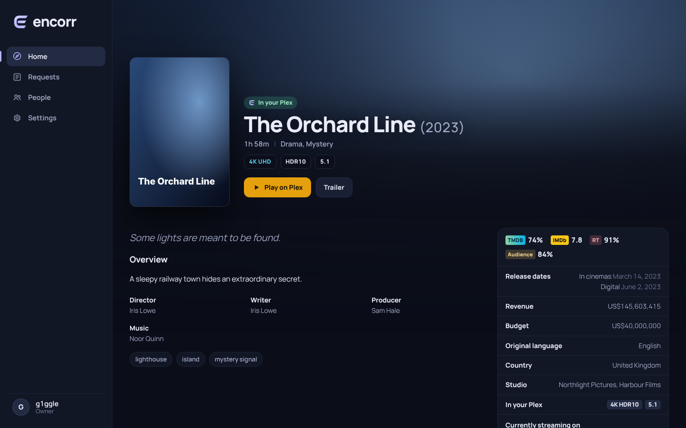
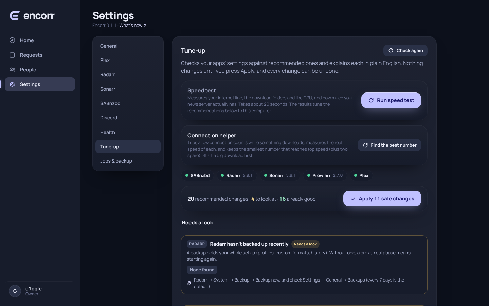
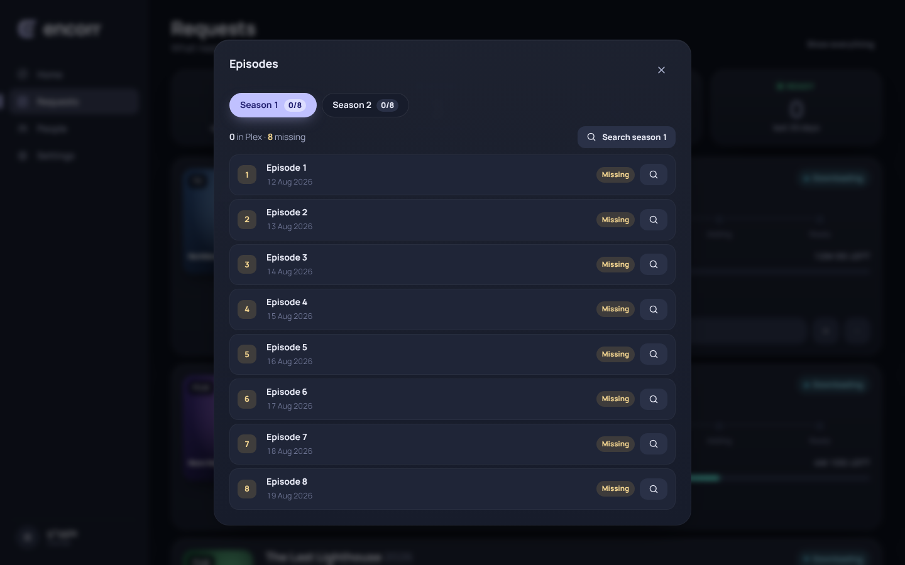
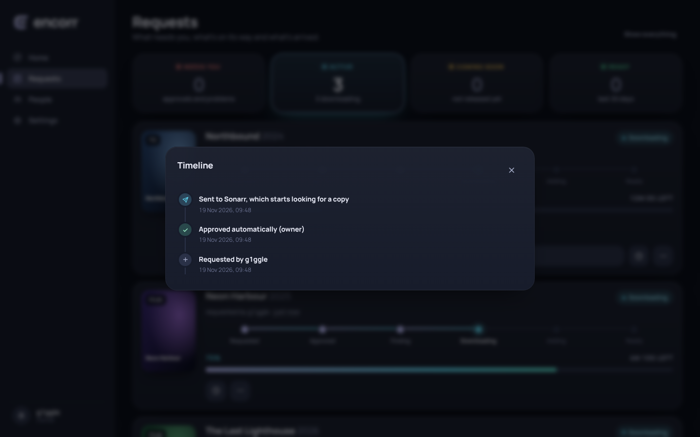
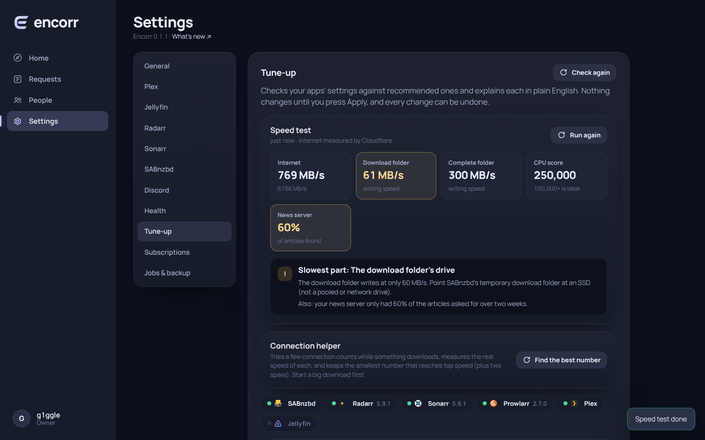
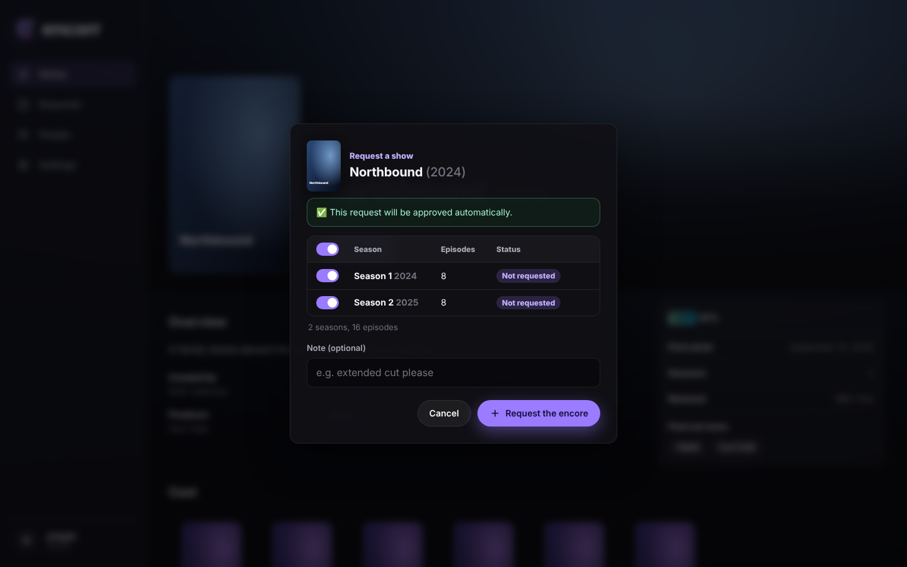
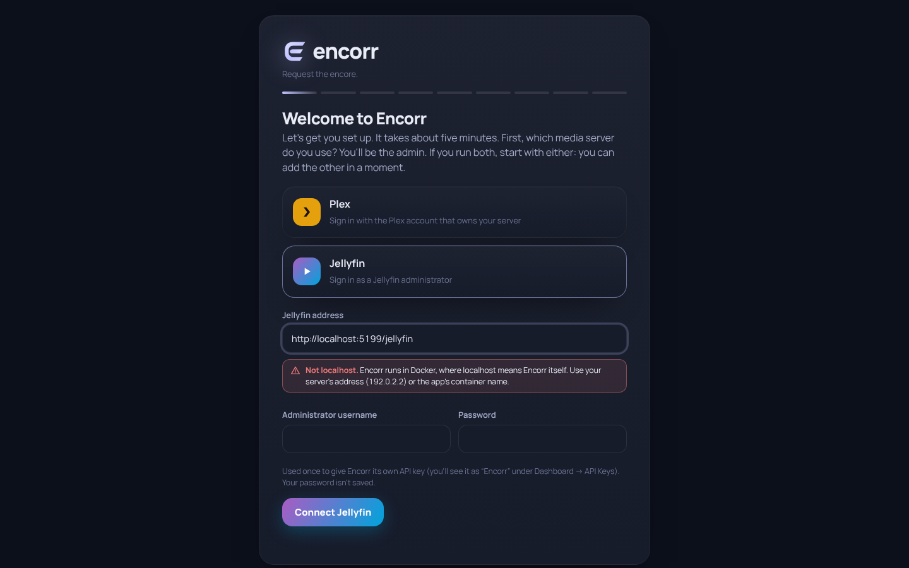
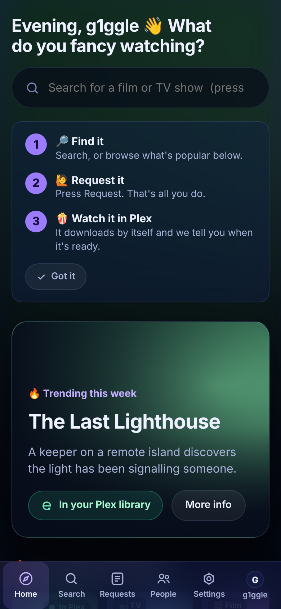
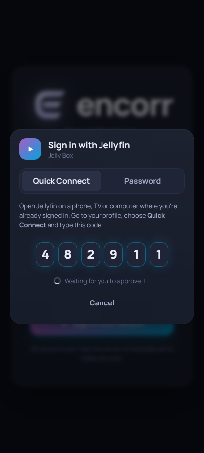

<p align="center"></p>

<h3 align="center">Request the encore.</h3>

<p align="center">Friends ask for a film or show. It downloads by itself.<br>They get a message when it's ready to watch in <b>Plex</b> or <b>Jellyfin</b>.</p>

<p align="center">
  <a href="https://github.com/FiTH-g1gGLe/Encorr/releases/latest"></a>
  <a href="https://github.com/FiTH-g1gGLe/Encorr/actions/workflows/build.yml"></a>
  <a href="https://github.com/FiTH-g1gGLe/Encorr/releases"></a>
  <a href="LICENSE"></a>
  
</p>

<p align="center">
  <a href="#-install-on-windows"></a>
  &nbsp;
  <a href="#-install-on-linux-docker--portainer"></a>
</p>

<p align="center"></p>

---

## 🍿 What is Encorr?

Encorr is a friendly front door to your media server. It does the same job as Overseerr, Jellyseerr and Ombi, but it's made to be simple for everyone.

<table>
<tr>
<td align="center" width="25%"><h3>1️⃣</h3><b>Find it</b><br><sub>Search or browse trending films and shows</sub></td>
<td align="center" width="25%"><h3>2️⃣</h3><b>Ask for it</b><br><sub>One tap on <b>Request</b></sub></td>
<td align="center" width="25%"><h3>3️⃣</h3><b>It downloads</b><br><sub>Radarr, Sonarr and SABnzbd do the work</sub></td>
<td align="center" width="25%"><h3>4️⃣</h3><b>Watch it</b><br><sub>"Your encore is ready", with a Play button</sub></td>
</tr>
</table>

- 🪶 **One program, nothing else to install.** No database, no extra software.
- 🧭 **A setup wizard** that finds your other apps for you.
- 🙂 **Plain English everywhere**, big buttons, and a progress bar anyone can read.
- 📱 **Works on phones** too. Add it to your home screen for an app icon.

---

## ✅ What you need

| | |
| --- | --- |
| 🎬 **A media server** | **Plex** or **Jellyfin**, or both |
| 📥 **Downloaders** | **Radarr** (films) and **Sonarr** (TV) |
| ➕ **Optional extras** | **SABnzbd** for live progress bars, **Prowlarr** for indexer checks, **Discord** for messages |

---

##  Install on Windows

1. **[Download Encorr for Windows](https://github.com/FiTH-g1gGLe/Encorr/releases/latest/download/Encorr-Windows.zip)** and unzip it.
2. **Double-click `encorr.exe`.** Your browser opens Encorr. If Windows asks about the firewall, allow **private networks**.
3. **Follow the setup wizard.** Choose **Plex** or **Jellyfin**, pick your libraries, then press **Find automatically** for Radarr and Sonarr.
4. **Keep it running.** Go to **Settings → General → Run in the background** and press **Turn on**. Encorr now starts with your computer.
5. **Invite people.** Go to **People → Add a person** and send them the message it gives you.

> **Updating:** download the new version and double-click it. That's it, your settings stay.

---

##  Install on Linux (Docker / Portainer)

Works on normal PCs and servers, and on ARM boards like a Raspberry Pi.

### With Portainer

1. Open **Portainer → Stacks → Add stack**, and name it `encorr`.
2. Choose **Web editor** and paste this:

   ```yaml
   services:
     encorr:
       image: ghcr.io/fith-g1ggle/encorr:latest
       container_name: encorr
       ports:
         - "5150:5150"
       environment:
         - TZ=Europe/London   # change to your time zone
       volumes:
         - encorr-data:/config
       restart: unless-stopped

   volumes:
     encorr-data:
   ```

3. Press **Deploy the stack**.
4. Open **`http://YOUR-SERVER-IP:5150`** in your browser (for example `http://192.168.1.50:5150`) and follow the setup wizard.

###  With plain Docker

```bash
docker run -d --name encorr -p 5150:5150 -v encorr-data:/config --restart unless-stopped ghcr.io/fith-g1ggle/encorr:latest
```

> [!TIP]
> **Use your server's address, not `localhost`.** Inside Docker, `localhost` means Encorr itself. Don't worry: Encorr fills the address boxes in for you, and warns you if you type `localhost`. **Find automatically** also searches your Docker network.

> **Updating:** in Portainer open **Stacks → encorr → Editor**, switch on **Re-pull image**, and press **Update the stack**. Your settings stay.

<details>
<summary><b>More: other containers, API keys filled in for you, and Linux without Docker</b></summary>
<br>

The **[Docker guide](docs/DOCKER.md)** covers:

- connecting to Jellyfin, Radarr, Sonarr and SABnzbd on the same Docker network
- letting Encorr read their API keys for you (read-only)
- keeping data in a folder instead of a volume
- running on Linux **without** Docker: download `Encorr-Linux-amd64.tar.gz` (or `-arm64`) from the [latest release](https://github.com/FiTH-g1gGLe/Encorr/releases/latest)

</details>

---

## ✨ What it can do

### 🔎 Find something to watch
- A rotating banner of what's trending, and rows that change every day: studios, streaming originals, genres, decades, hidden gems and more.
- Search splits results into **Films** and **TV shows**, and shows what you already have.
- Film and show pages with cast, crew, trailers, ratings (TMDB, IMDb, Rotten Tomatoes), release dates and where it's streaming.
- **Collections:** request every film in a series you haven't got, in one go.

### 📬 Requests anyone can follow
- Four simple lists: **Needs you**, **Active**, **Coming soon** and **Ready**.
- A six-step tracker on every request: Requested → Approved → Finding → Downloading → Adding → **Ready**.
- Episode by episode for TV: what you have, what's downloading, what's missing.
- A timeline of everything that happened to a request.
- **Play on Plex** and **Play on Jellyfin** buttons the moment it arrives.

### 🩹 Looks after itself
- **Auto-fix** every 5 minutes: imports stuck downloads, swaps failed or stalled ones for another copy, and tidies SABnzbd.
- **Download controls** for the owner: pause, move to the front, try another copy, or pick a copy yourself.
- Searches again by itself for anything that's stuck.
- A **Health page** in plain English, with fix buttons.

### 🪼 Plex and Jellyfin, together or apart
- Use Plex, Jellyfin, or both at once.
- Friends sign in with Plex, Jellyfin, a **Quick Connect** code from their Jellyfin app, or a username and password.
- Encorr checks both libraries, so nothing gets downloaded twice.
- Plex watchlists turn into requests automatically.

### 🔧 Tune-up
- Checks the settings of SABnzbd, Radarr, Sonarr, Prowlarr, Plex and Jellyfin against trusted guides, and explains each one simply.
- Apply the safe ones in one go, and **undo** anything later.
- A **speed test** that finds what's slowing your downloads down.
- It never touches passwords, addresses or remote access.

### 🗓️ Subscriptions
- Your news servers, indexers and data blocks in one place, with expiry countdowns and data left.
- Add costs to see what you spend a year.
- Discord reminders before anything runs out, and when a block is nearly used up.

### 🎨 And the rest
- Accounts with roles: **Owner**, **Trusted** (no approval needed) and **Friend** (with limits).
- Discord messages for requests, approvals, problems and "your encore is ready".
- Midnight or graphite themes with 8 accent colours.
- Works on Windows, Linux and Docker.

---

## 📸 Screenshots

| | |
| --- | --- |
|  |  |
| **Film pages** with everything you'd want to know | **Requests:** where everything is up to |
|  |  |
| **Plex and Jellyfin:** a Play button for each | **Quick Connect:** sign in with a code |
|  |  |
| **Tune-up:** better settings, with undo | **Subscriptions:** what renews when |

<details>
<summary><b>More screenshots</b></summary>
<br>

| | |
| --- | --- |
|  |  |
| **Episodes:** have, downloading, missing | **Download controls** |
|  |  |
| **Pick a copy** yourself | **Timeline** of a request |
|  |  |
| **Speed test** | **Health** checks with fix buttons |
|  |  |
| **Setup:** start with Plex or Jellyfin | **Jellyfin settings** |
|  |  |
| **Collections** | **Season picker** |
|  |  |
| **Search** | **People and roles** |
|  |  |
| **Docker:** warns you about `localhost` | **Your colours** |

<p align="center"> &nbsp;  &nbsp; </p>

</details>

---

## 🌍 Let friends in from outside your home

Encorr works inside your home straight away. To let friends use it from anywhere, give it a web address like `https://encorr.yourdomain.com`.

The easiest safe way is a free **Cloudflare Tunnel**: no router changes, your home address stays hidden, and you get the padlock (HTTPS) for free.

📖 **[Step-by-step guide](docs/REMOTE-ACCESS.md)**

---

## ❓ Questions

<details>
<summary><b>Is it free?</b></summary>
<br>Yes, completely, and open source (MIT licence).
</details>

<details>
<summary><b>Do I need Docker?</b></summary>
<br>No. On Windows it's a single program you double-click. Docker is just the easy way on Linux.
</details>

<details>
<summary><b>Is it safe to put on the internet?</b></summary>
<br>Passwords are stored as slow, salted hashes and API keys are encrypted. Sign-in locks out after repeated wrong guesses. Only Encorr goes online: Radarr, Sonarr, Prowlarr and SABnzbd stay private.
</details>

<details>
<summary><b>Where are my settings kept?</b></summary>
<br>Windows: <code>C:\ProgramData\Encorr</code>. Docker: the <code>/config</code> volume. Linux: <code>~/.config/encorr</code>.
</details>

<details>
<summary><b>Something isn't working</b></summary>
<br>Open <b>Settings → Health</b> first: it explains problems in plain English and often has a fix button. If you're still stuck, <a href="https://github.com/FiTH-g1gGLe/Encorr/issues">open an issue</a> with a screenshot.
</details>

---

## 🛣️ Coming next

- [ ] "Report a problem" so friends can flag a bad file
- [ ] IMDb and Rotten Tomatoes ratings for everything
- [ ] Android app
- [ ] Request from Discord
- [ ] Mac version

---

<details>
<summary><b>🛠️ For developers</b></summary>
<br>

Encorr is written in Go (1.24+). The web interface is built into the program.

```sh
go build -o encorr ./cmd/encorr                                  # this machine
GOOS=windows GOARCH=amd64 go build -o encorr.exe ./cmd/encorr    # Windows
go test ./...                                                     # tests
docker build -t encorr .                                          # Docker image
```

Every push to `main` is tested and published as a release (Windows zip, Linux downloads and the Docker image). The TMDB key comes from a repository secret and is never in the code.

**Trying it without real servers:** `encorr-fake` pretends to be Plex, Jellyfin, TMDB, Radarr, Sonarr, SABnzbd and Discord.

```sh
go run ./cmd/encorr-fake -port 5199 &
ENCORR_DEV_FAKE=http://localhost:5199 go run ./cmd/encorr -config /tmp/encorr-dev
```

Use TMDB key `good-key`, Radarr `http://localhost:5199/radarr` with key `radarr-key` (Sonarr: `/sonarr`, `sonarr-key`; SABnzbd: `/sabnzbd`, `sab-key`; Jellyfin: `/jellyfin`, user `jfadmin`, password `jfpass`).

**Command-line options:** `-port 5150`, `-config <folder>`, `-no-browser`, `-version`, and on Windows `encorr install` / `encorr uninstall`.

| Folder | What's in it |
| --- | --- |
| `cmd/encorr` | The program: web server, jobs, Windows service |
| `internal/app` | Requests, jobs, accounts, health, Tune-up and the `/api/v1` API |
| `internal/arr` | Radarr, Sonarr and Prowlarr |
| `internal/sab` | SABnzbd |
| `internal/plex` | Plex sign-in, servers, watchlists, scans |
| `internal/jellyfin` | Jellyfin sign-in, Quick Connect, libraries, scans |
| `internal/netfind` | Finds the other apps on the network (used in Docker) |
| `internal/tmdb` | Film and TV information |
| `internal/notify` | Discord |
| `internal/store` | The data file, with encrypted secrets and backups |
| `internal/web` | The web interface |
| `internal/fake` | Pretend services for tests and previews |

There's also a [testing guide](TESTING.md).

</details>

---

## 🙏 Thanks

Encorr's request flow follows ideas proven in [Seerr](https://github.com/seerr-team/seerr) (MIT), with ideas from Ombi, Watchlistarr, Requestrr, Doplarr, Reiverr and MediaManager. No code from GPL or AGPL projects is included. Settings advice comes from the [TRaSH Guides](https://trash-guides.info), SABnzbd's guide and the Servarr wiki. Film and TV data comes from [TMDB](https://www.themoviedb.org); Encorr uses the TMDB API but is not endorsed or certified by TMDB. Service logos (Plex, Jellyfin, Radarr, Sonarr, Prowlarr, SABnzbd, Discord, TMDB, IMDb, Rotten Tomatoes) belong to their owners and are only used to show what Encorr works with.

<p align="center"><sub>MIT © 2026 g1gGLe · <a href="LICENSE">Licence</a></sub></p>
