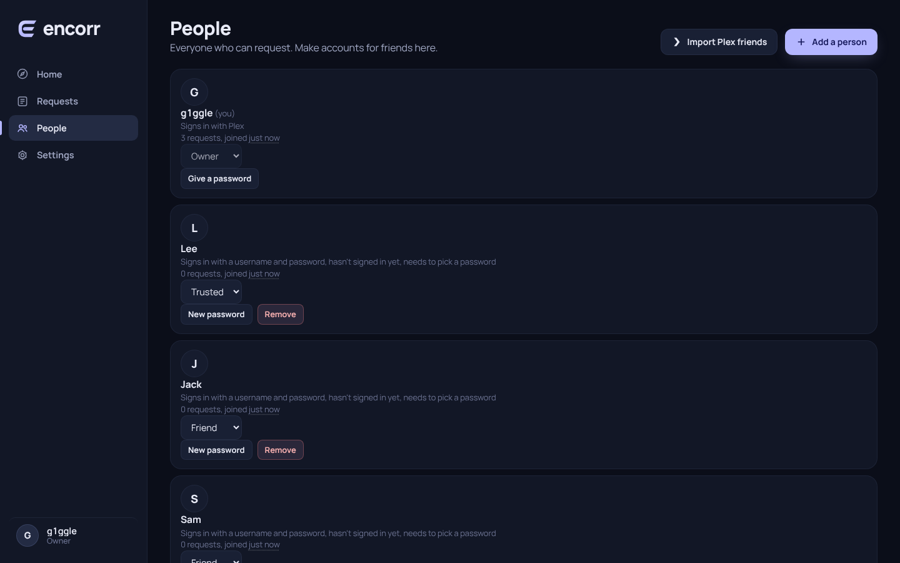
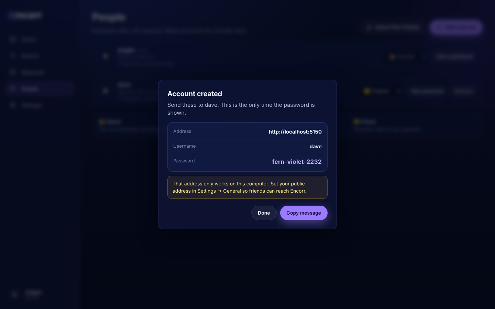
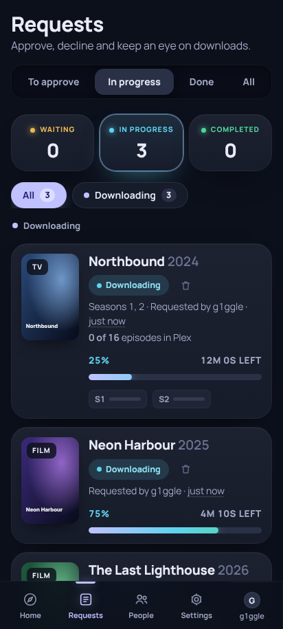

<p align="center"></p>

<p align="center"><b>Request the encore.</b><br>A friendly media request app for Plex. Friends ask for a film or show, and it turns up in Plex by itself.</p>

<p align="center">
  <a href="https://github.com/FiTH-g1gGLe/Encorr/releases/latest"></a>
  <a href="https://github.com/FiTH-g1gGLe/Encorr/actions/workflows/build.yml"></a>
  <a href="https://github.com/FiTH-g1gGLe/Encorr/releases"></a>
  <a href="LICENSE"></a>
  
  
  
  
</p>

<p align="center"><a href="https://github.com/FiTH-g1gGLe/Encorr/releases/latest/download/Encorr-Windows.zip"><b>⬇️ Download Encorr for Windows</b></a> &nbsp;·&nbsp; <a href="TESTING.md">🧪 Testing guide</a> &nbsp;·&nbsp; <a href="https://github.com/FiTH-g1gGLe/Encorr/releases">📝 What's new</a></p>

<p align="center"></p>

## What is it? 🍿

Encorr is the front door to your Plex server. People sign in, find something to watch, and press **Request**. Encorr hands it to Radarr (films) or Sonarr (TV), SABnzbd downloads it, and Encorr tells them when it's ready to watch.

It does the same job as Overseerr, Jellyseerr and Ombi, but it's built to be:

- **🪶 Simple to run:** one program file. No Docker, no Node, no Java, no database server.
- **🧭 Simple to set up:** a wizard signs you in with Plex and finds Radarr, Sonarr and SABnzbd on the same machine by itself.
- **🙂 Simple to use:** plain English everywhere, big buttons, and a progress tracker anyone can read.
- **🌙 Always on:** one click runs it in the background as a Windows service that starts with the computer.

## Features ✨

| | |
| --- | --- |
| 🗺️ **Request journey** | Every request shows four steps: Requested → Approved → Downloading → In Plex. The line fills as it downloads, and the last step lights up when it's ready. |
| ⬇️ **Live downloads** | Percentage, speed and time left come straight from SABnzbd, refreshed every few seconds, with plain stages like "📦 Unpacking" and "🚚 Moving it into your library". |
| ⚡ **Instant "ready"** | When a download finishes, Encorr asks Plex to scan just that folder and checks within seconds, so requests turn green almost straight away. |
| 👥 **Accounts for friends** | Make accounts with a username and password, or let people sign in with Plex. Owner, Trusted (no approval needed) and Friend (needs approval, with weekly limits). |
| 🔎 **Discover and search** | Trending, popular films and TV, and coming soon to UK cinemas. Posters show what's already in Plex or already requested. |
| 📺 **Proper TV handling** | Pick seasons; only those are monitored. Part-arrived shows say "18 of 24 episodes in Plex". |
| 🔁 **Clever hand-off** | Handles titles Radarr/Sonarr already have (unmonitored, monitored or downloaded) without duplicates. |
| 👀 **Plex watchlists** | Add something to your Plex watchlist and Encorr requests it for you. |
| 💬 **Discord** | Rich messages for new requests, approvals, failures and "Your encore is ready", with @mentions. |
| ❤️ **Health page** | Plain-English checks for Plex, TMDB, Radarr, Sonarr (including free disk space), SABnzbd, Discord and the data folder. |
| 🌍 **Reach it from anywhere** | Works behind a Cloudflare Tunnel or any reverse proxy, with secure cookies and the visitor's real address used for rate limits. |
| 📱 **Phone-friendly** | Works in any phone browser, with a bottom menu; "Add to Home screen" gives you an app icon. |
| 🎨 **Looks the part** | Navy frosted glass with a violet or coral accent, tooltips on everything, and a `/` shortcut to search. |

## Screenshots 📸

| | |
| --- | --- |
|  |  |
| **Live progress** on a film's page | **Every request**, and where it's up to |
|  |  |
| **People:** accounts and what each person can do | **New account:** details ready to send to a friend |
|  |  |
| **Setup wizard:** finds Radarr and Sonarr for you | **Health:** what's working, and how to fix what isn't |

<p align="center"> &nbsp; </p>

## Get started (Windows) 🚀

1. **[Download Encorr-Windows.zip](https://github.com/FiTH-g1gGLe/Encorr/releases/latest/download/Encorr-Windows.zip)** and unzip it. The link always gives you the newest version.
2. **Double-click `encorr.exe`.** Your browser opens at <http://localhost:5150>. If Windows asks about the firewall, allow private networks.
3. **Follow the setup wizard:** sign in with Plex, pick your server and libraries, and press Test on Radarr and Sonarr (usually already filled in).
4. **Run it in the background:** go to Settings → General → *Run in the background* → **Turn on**, and press Yes when Windows asks. Encorr now starts with the computer and restarts itself if it ever stops.
5. **Invite people:** go to People → *Add a person*, then copy the message and send it.

**Updating:** download the new version and double-click it. It updates the background copy for you.

Encorr keeps its data in `C:\ProgramData\Encorr` (Linux: `~/.config/encorr`). Passwords are stored as slow salted hashes, and API keys and tokens are encrypted.

### Letting friends in from outside your home 🌍

Out of the box Encorr only works **inside your home** (`http://localhost:5150` on the server). To let friends request from their own homes or phones, Encorr needs a web address on the internet, such as `https://encorr.yourdomain.com`, that leads back to your server.

The easy, safe way is a free **[Cloudflare Tunnel](https://developers.cloudflare.com/tunnel/)**. A small Cloudflare program on your server connects **out** to Cloudflare, and visitors come back in through that connection:

```
Friend's phone ──► https://encorr.yourdomain.com ──► Cloudflare ══ tunnel ══► your server ──► Encorr
```

- 🔒 **No router changes**: no ports opened, and your home IP stays hidden.
- 🔐 **Free HTTPS padlock**, so passwords are encrypted on the way.
- 💷 **Free**: you only need a domain name (about £8–10 a year).
- 🔁 **Survives restarts**: it runs as a Windows service, like Encorr's background mode.

**The short version** (about 20–30 minutes):

1. Turn on **Settings → General → Run in the background**, so Encorr is always up.
2. Add your domain to a free [Cloudflare](https://dash.cloudflare.com) account and switch its nameservers to Cloudflare's.
3. In Cloudflare go to **Networking → Tunnels → Create Tunnel**, pick Windows, and run the install command it gives you on the server. ⚠️ Keep that command's long code private: it's the key to your tunnel.
4. Add a **published application route**: subdomain `encorr`, your domain, type **HTTP**, URL **`localhost:5150`**.
5. In Encorr set **Settings → General → Public address** to `https://encorr.yourdomain.com`, so invite messages carry the right link.
6. Turn Wi-Fi off on your phone and open the address to check it works.

Only Encorr goes on the internet: Radarr, Sonarr, Prowlarr and SABnzbd stay private. Encorr protects the sign-in page with hashed passwords, a lock-out after 10 wrong guesses, and secure cookies.

📖 **[Full step-by-step guide, with safety tips, troubleshooting and alternatives →](docs/REMOTE-ACCESS.md)**

### Options

| Option | What it does |
| --- | --- |
| `-port 5150` | Port for the web page |
| `-config <folder>` | Where Encorr keeps its data |
| `-no-browser` | Don't open the browser on start |
| `encorr install` / `encorr uninstall` | Turn background mode on or off from the command line |
| `-version` | Print the version |

## What's been built so far ✅

- [x] Setup wizard with Plex sign-in, auto-detected Radarr, Sonarr and SABnzbd, and a built-in TMDB key
- [x] Discover, search, title pages, trailers, seasons and "more like this"
- [x] Requests with approval, quotas, notes, retry and cancel
- [x] Journey tracker, live SABnzbd progress and a Completed tab
- [x] Instant Plex scan and fast "ready" detection (works with old and new Plex agents)
- [x] Encorr accounts (username + password) alongside Plex sign-in
- [x] Discord notifications and Plex watchlist requests
- [x] Health page and background jobs
- [x] Windows background service with one-click on/off and double-click updates
- [x] Friendly redesign: labelled menu, home page guide, tooltips and emojis
- [x] Tested end to end against simulated Plex, TMDB, Radarr, Sonarr, SABnzbd and Discord, plus a real Windows 11 server

## Coming next 🛣️

- [ ] Android app (request, approve and get notified on your phone)
- [ ] Discord bot (request from Discord)
- [ ] Invite links and "report a problem" with a title
- [ ] Tray icon and code-signed builds
- [ ] Mac support

## Building from source 🛠️

Needs Go 1.24 or newer.

```sh
go build -o encorr ./cmd/encorr                                    # this machine
GOOS=windows GOARCH=amd64 go build -o encorr.exe ./cmd/encorr      # Windows
go test ./...                                                       # tests
```

Every push to `main` is tested and published as a release, with the TMDB key added from a repository secret (it's never in the code).

### Trying it without a real server

`encorr-fake` pretends to be Plex, TMDB, Radarr, Sonarr, SABnzbd and Discord:

```sh
go run ./cmd/encorr-fake -port 5199 &
ENCORR_DEV_FAKE=http://localhost:5199 go run ./cmd/encorr -config /tmp/encorr-dev
```

Use TMDB key `good-key`. For Radarr use `http://localhost:5199/radarr` and key `radarr-key` (Sonarr: `/sonarr` and `sonarr-key`; SABnzbd: `/sabnzbd` and `sab-key`).

## Project layout 🗂️

| Folder | What's in it |
| --- | --- |
| `cmd/encorr` | The program: web server, background jobs and the Windows service |
| `internal/app` | Request engine, jobs, accounts, health checks and the `/api/v1` API |
| `internal/arr` | Radarr and Sonarr client, including auto-detection |
| `internal/sab` | SABnzbd client for live download progress |
| `internal/plex` | plex.tv sign-in, servers, friends, watchlists, library scans |
| `internal/tmdb` | Film and TV information from TMDB |
| `internal/notify` | Discord notifications |
| `internal/store` | The data file, with encrypted secrets and backups |
| `internal/web` | The web interface (built into the program) |
| `internal/fake` | Pretend services for tests and previews |

## Credits 🙏

Encorr's request flow follows ideas proven in [Seerr](https://github.com/seerr-team/seerr) (MIT), with ideas from Ombi, Watchlistarr, Requestrr, Doplarr, Reiverr and MediaManager. No code from GPL or AGPL projects is included. Quality advice comes from the [TRaSH Guides](https://trash-guides.info). Film and TV data comes from [TMDB](https://www.themoviedb.org); Encorr uses the TMDB API but is not endorsed or certified by TMDB.

## Licence

MIT © 2026 g1gGLe. See [LICENSE](LICENSE).
